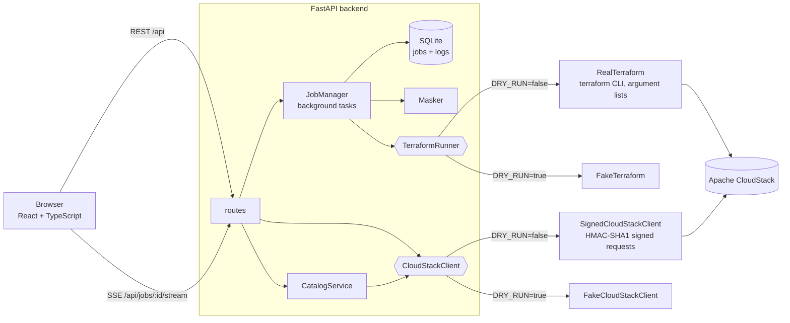
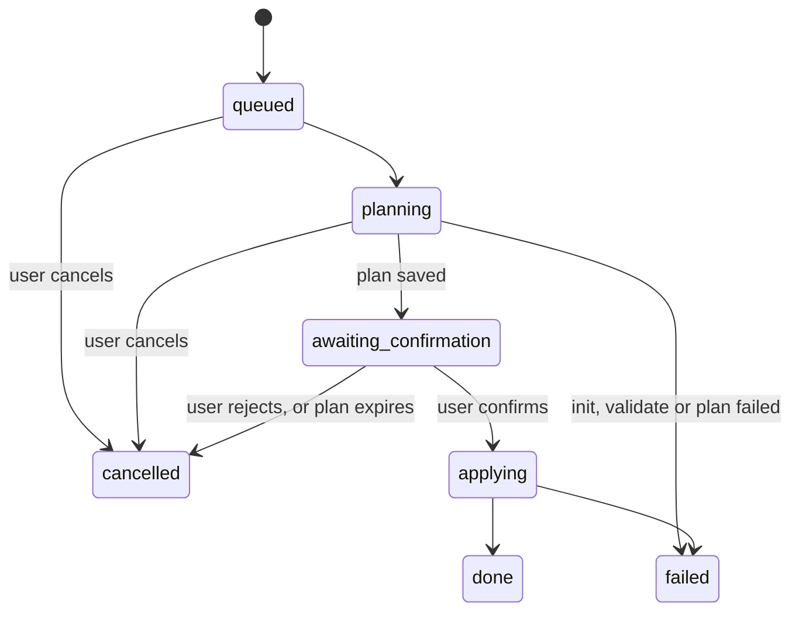

# CloudStack provisioning portal

Fill in a form, review the Terraform plan, confirm, and watch the instances get
created on Apache CloudStack. The backend runs Terraform in two stages and
streams its output to the browser line by line.


*Recorded in DRY_RUN mode: form, live plan, confirm and apply, VM actions, destroy.
To record it again, see `frontend/e2e/record-demo.mjs`.*

- Backend: Python 3.12, FastAPI, Pydantic v2, SQLite
- Frontend: React + TypeScript (Vite)
- Infrastructure: Terraform with the `cloudstack/cloudstack` provider
- Live logs: Server-Sent Events

## Quick start in DRY_RUN mode

`DRY_RUN=true` replaces Terraform and the CloudStack API with fakes that produce
realistic output. You need no CloudStack, no credentials and no Terraform binary.

With Docker:

```bash
cp .env.example .env        # DRY_RUN=true is the default
docker compose up --build
# open http://localhost:8080
```

Without Docker, in two terminals:

```bash
cd backend
python3.12 -m venv .venv && .venv/bin/pip install -r requirements-dev.txt
DRY_RUN=true .venv/bin/uvicorn app.main:app_factory --factory --port 8000
```

```bash
cd frontend
npm ci
npm run dev                 # open http://localhost:5173
```

Things to try in DRY_RUN:

- Submit the form, reload the page while the plan is running: the log replays and continues.
- A name starting with `failplan` makes stage 1 fail. `failapply` makes stage 2 fail after the
  first instance, so you can try destroying the leftovers of a failed apply.
- Open a finished job and use "Destroy these instances..." to go through the destroy flow.
- Instances "created" by a job show up in the VM table, where start, stop and reboot work.
  The fake VM list lives in memory and resets when the backend restarts.

## Running against a real CloudStack

1. Set `DRY_RUN=false`, `CLOUDSTACK_API_URL`, `CLOUDSTACK_API_KEY` and
   `CLOUDSTACK_SECRET_KEY` in `.env`. The backend refuses to start if one is missing.
2. Run the preflight check. It only makes read-only calls and creates nothing:

   ```bash
   cd backend && .venv/bin/python -m app.check
   # or, with Docker:
   docker compose run --rm backend python -m app.check
   ```

   It reports whether Terraform is installed, whether the credentials work, and how
   many zones, offerings, templates, networks, keypairs and disk offerings it found.
3. `docker compose up --build` (the backend image includes Terraform), or run the
   backend locally with `terraform` on your `PATH`.
4. For the first real run, create one small instance and read the plan before you
   confirm. Then destroy it from its job page.

Status of the real path: the resource arguments in `terraform/` were checked by hand
against the source of provider v0.6.0 (`cloudstack_instance` and `cloudstack_disk`),
and the provider does read the three `CLOUDSTACK_*` environment variables. Nobody has
run `terraform validate` or an apply with it yet, so treat the first run as a test.

Zones, offerings, templates and networks in the form are then fetched from
CloudStack (cached for 5 minutes) and every submitted value is checked against them.

The portal has no login. Compose binds both ports to `127.0.0.1`; put it behind
your own authentication before exposing it anywhere.

## Instance options

| Option | Notes |
|---|---|
| Name, zone, network, compute offering, template, root disk size, instance count | Required. Lists come from CloudStack. |
| SSH keypair | Optional, one of the account's keypairs. |
| Data disk | Optional extra volume per instance, from a disk offering. Custom-size offerings ask for a size. |
| Tags | Up to 10 `key=value` pairs, set on instances and data disks. |
| Instance group | Optional label for organising VMs. |
| User data | Optional cloud-init or script, up to 16 KB. Marked sensitive in Terraform, kept out of the logs, and the API only ever answers `[hidden]`. It is stored in the job database and in Terraform state, so protect the data volume. |
| Start after creation | On by default. Off leaves the instances stopped. |

## Architecture



Routes and the job manager only know the two interfaces. `build_backends()` in
`app/main.py` is the single place that picks real or fake, so the rest of the
backend and the whole frontend behave the same in both modes.

### Job lifecycle



- **Stage 1** copies `terraform/` into `data/workdirs/<job id>/`, writes the form
  values to `terraform.tfvars.json`, then runs `init`, `validate`, `plan -out=tfplan`
  and `show -json tfplan` for the summary. The SHA-256 of the plan file is stored.
- **Stage 2** only starts from `awaiting_confirmation`, checks that the plan file
  still has the stored hash, and runs `terraform apply tfplan`. Nothing is created
  before that.
- **Destroy** is a second kind of job that points at a finished create job. It runs
  `plan -destroy` against that job's state, shows what will be removed and waits for
  confirmation like any other plan. It is also offered for a create job whose apply
  failed, because a failed apply usually leaves some instances behind.
- A queued or planning job can be cancelled, which stops Terraform. A running apply
  cannot: stopping it halfway is worse than letting it finish. For the same reason a
  backend shutdown waits up to `SHUTDOWN_GRACE_SECONDS` for running applies.
- Transitions are enforced in `app/jobs/state.py` and applied atomically in the
  store, so a second confirm gets a 409.
- Terraform state lives in `data/state/<job id>/`, outside the working directory.
  Cleanup deletes working directories of finished jobs after 24 hours and expires
  unconfirmed plans after `PLAN_TTL_MINUTES` (default 60), but never touches state.
- If the backend restarts, jobs that were planning or applying are marked failed.
  Jobs waiting for confirmation survive.

### Log streaming

Every output line is masked, stored in SQLite with a per-job sequence number and
sent as an SSE `log` event whose `id` is that number. A new connection replays the
stored log and then follows the job. When a connection drops, the browser's
`EventSource` reconnects with `Last-Event-ID` and the backend resumes after that
line. `status` events carry state changes; `end` closes the stream.

## API

| Method | Path | Purpose |
|---|---|---|
| GET | `/api/health` | Liveness and whether DRY_RUN is on |
| GET | `/api/catalog` | Allowed zones, offerings, templates, networks, limits |
| POST | `/api/jobs` | Validate the form, create a job, start stage 1 (202) |
| GET | `/api/jobs` | Jobs, newest first |
| GET | `/api/jobs/{id}` | Status, timestamps, plan summary, error |
| GET | `/api/jobs/{id}/logs` | Stored log as JSON (`?after=<seq>`) |
| GET | `/api/jobs/{id}/stream` | SSE stream with replay |
| POST | `/api/jobs/{id}/confirm` | Start stage 2 (409 unless awaiting confirmation) |
| POST | `/api/jobs/{id}/cancel` | Reject the plan, or stop a queued or planning job |
| POST | `/api/jobs/{id}/destroy` | Start a destroy job for the instances of a create job (202) |
| GET | `/api/vms`, `/api/vms/{id}` | Live VM status from the CloudStack API |
| POST | `/api/vms/{id}/{start,stop,reboot}` | Power actions through the CloudStack API; waits for the async job |

Validation errors come back as `422 {"detail": [{"field": "...", "message": "..."}]}`.
Interactive docs: `http://localhost:8000/docs`.

## Security

- The API key and secret are read from the environment by the backend only. They are
  passed to Terraform through its process environment and never appear in the repo,
  in command lines, in API responses or in the frontend. `.env` is git-ignored.
- Terraform is started with `asyncio.create_subprocess_exec` and an argument list.
  There is no shell. User values only go into `terraform.tfvars.json`.
- A saved plan can only be applied if its file still has the hash recorded when the
  plan was shown, and unconfirmed plans expire.
- Input is validated three times: in the browser, with Pydantic on the backend
  (format, ranges, and allowed values from the catalog), and by `validation` blocks
  in the Terraform variables.
- Log lines pass through `Masker` before they are stored or streamed. It replaces the
  configured secret values and anything that looks like `api_key=...`,
  `secret_key=...`, `signature=...`, `password=...` or `token=...`.
- VM actions accept only a UUID and one of three fixed action names.

## Tests

```bash
cd backend && .venv/bin/pytest -q && .venv/bin/ruff check .
cd frontend && npm run lint && npm run typecheck
```

There is also a browser test of the whole flow (validate, plan, reload, confirm,
destroy). Start the backend with `DRY_RUN=true` and the frontend with `npm run dev`,
then run `npm run e2e` in `frontend/`. It needs Chrome; set `CHROME_PATH` if it is not
at `/usr/bin/google-chrome`. It refuses to run against a backend that is not in DRY_RUN.

The backend suite covers form validation, state transitions, the two-stage flow,
SSE output and resume, the signed API client and the routes with a mocked client,
DRY_RUN behaviour, failed plans and applies, masking and cleanup. `RealTerraform`
is tested against a stub `terraform` executable, so those tests check argument
lists, environment and error handling without CloudStack.

GitHub Actions (`.github/workflows/ci.yml`) runs pytest and ruff, the frontend
lint, type check and build, the browser test, and `terraform fmt -check` plus
`terraform validate`.

## Layout

```
backend/app/
  main.py                   app factory, picks real or fake backends
  config.py                 settings from environment variables
  routes/                   meta (health, catalog), jobs (+ SSE), vms
  services/terraform.py     TerraformRunner, RealTerraform, FakeTerraform
  services/cloudstack_api.py  CloudStackClient, signed client, fake client
  services/catalog.py       cached allowed values
  services/masking.py       secret redaction
  jobs/                     state machine, SQLite store, broker, manager
  models/                   Pydantic models
backend/tests/
frontend/src/
  api/                      typed client
  hooks/useJobStream.ts     SSE hook
  components/, pages/
terraform/                  root config + modules/vm
```

## Known limits

- One backend process. Jobs and stream wake-ups live in that process, so run a
  single uvicorn worker.
- A deployment can be created and destroyed, but not changed: there is no resize or
  scale flow for existing instances.
- Instances get an SSH keypair but no firewall, port-forwarding or security group
  rules, so whether they are reachable depends on the network you pick.
- No login and no record of who confirmed a plan.
- Terraform state is on a local volume: no remote backend, no backup.
